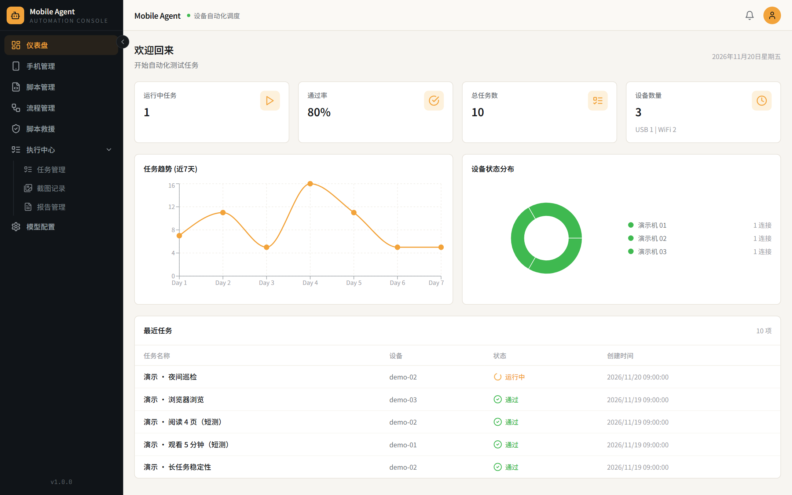
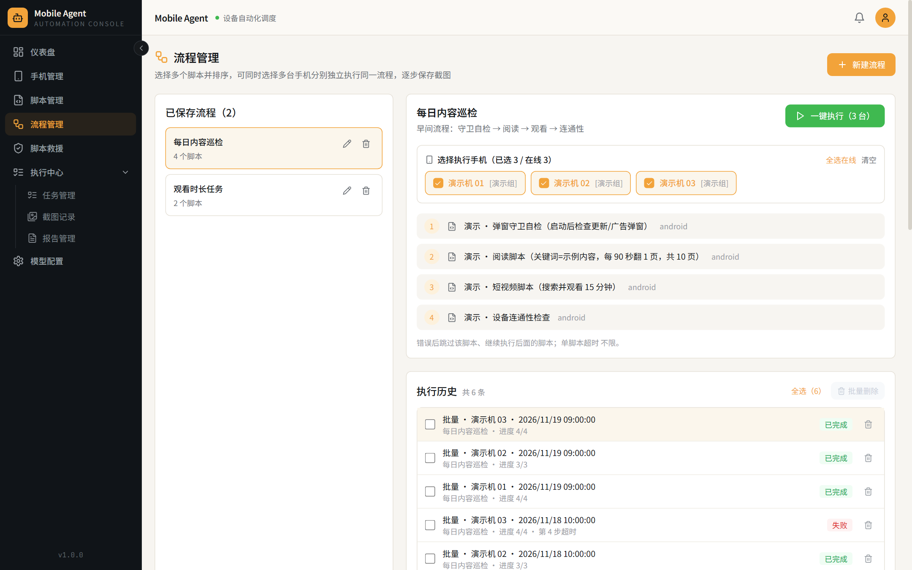
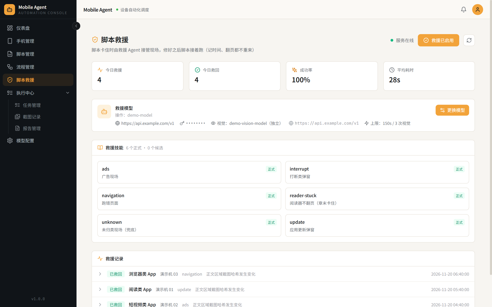
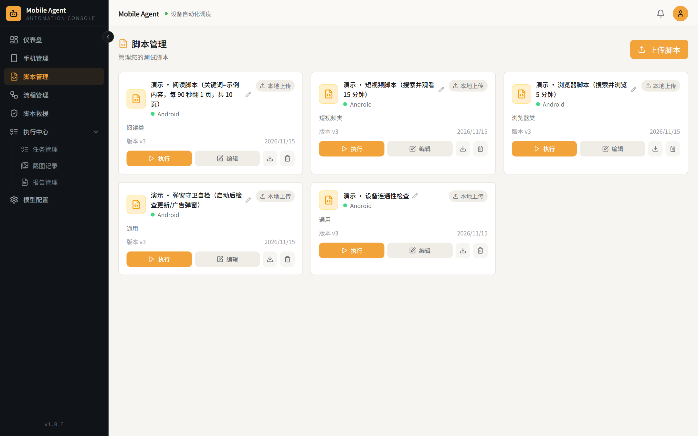
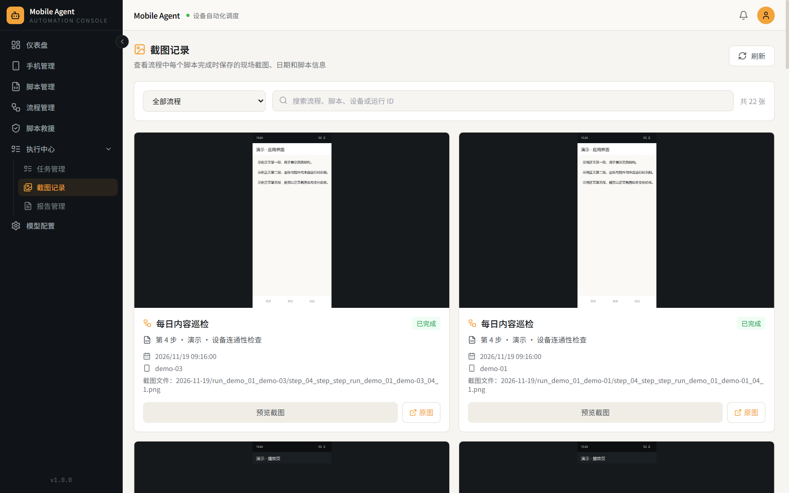

# Mobile Agent · 设备自动化控制台

> 一个面向多设备手机自动化的调度与运维平台。脚本自己跑，跑不动时由救援 Agent 接管现场，
> 救回来的经验自动沉淀成规则，下次直接命中。
> 已适配 8 个主流 App，覆盖阅读、短视频、浏览器三类场景。

**多设备手机自动化调度平台** —— 脚本编排、批次并行、断线自愈，以及三级兜底的救援 Agent
（规则 → 视觉 → 模型），救回的经验自动沉淀为可复用技能。基于 Open-AutoGLM 内核的社区二开。



---

## 功能总览

| 能力 | 一句话 |
|---|---|
| 流程编排 | 多个脚本按顺序组成一条流水线，可配单步超时与失败策略 |
| 多机并行 | 一次启动为多台手机各建独立 run，共享批次号，台内串行、台间并行 |
| 执行留证 | 每一步自动截图入库，可回看每一步的日志、耗时与现场画面 |
| 脚本管理 | 版本化存储、原子部署、哈希校验后才生效 |
| 设备管理 | ADB 远程接入，掉线自动重连，运行前 90 秒设备就绪门槛 |
| 救援服务 | 脚本卡住时接管现场，不重跑步骤、不丢进度；救没救回由脚本验收 |

---

## 一、流程编排：把脚本排成一条可审计的流水线

### 1.1 流程 = 脚本序列

一条流程（workflow）只定义三件事：**跑哪些脚本、按什么顺序、出错怎么办**。

| 字段 | 含义 |
|---|---|
| `script_ids` | 脚本 id 数组，**数组顺序即步骤顺序**，前端上移/下移调整 |
| `continue_on_error` | 失败策略，默认 0（首错即停） |
| `step_timeout` | 单脚本超时，秒；0 = 不限，上限 86400（前端按分钟填，0–1440） |

步骤本身不是独立实体——**执行开始时**把「第几步 = 哪个脚本、脚本叫什么」快照写进
`workflow_step_runs`。之后改流程、改脚本名都不会动到已发生的这一次执行记录；
脚本正文则在每一步**开始执行时**才从库里读取，便于在长流程中途修订脚本。

### 1.2 一次启动多台手机 = 一个批次

点一次「一键执行 N 台」，后端做三件事：

1. **去重 + 校验在线**：网络接入型设备会先自动重连一次、等待 1 秒再复查；仍有离线设备则整批拒绝。
2. **校验设备不忙**：该设备存在 `pending` / `executing` 的执行记录时直接拒绝，避免两路 adb 输入互相打架。
3. **一次性建账**：为每台手机插一条 `workflow_runs`，并预生成该机的全部 `workflow_step_runs`，
   同一个 `batch_id` 串起整批，前端历史列表以「批量 ·」前缀标识。

**并行模型**：每台手机一个 asyncio 任务，任务间并行、**台内严格串行**——同一台手机永远只有一步在跑。
阻塞点用子进程 + 线程收尾，事件循环不被卡住。前端每 2 秒刷新一次运行中流程，忙碌设备在选择器里
禁用并自动移出已选集合。

服务重启时会把遗留的 `pending` / `executing` 统一置为 `cancelled`（未跑的步骤置 `skipped`），
防止手机被永久误判为忙碌。

### 1.3 每一步怎么执行

脚本正文存在数据库里，执行时：

1. 先把脚本写成系统临时目录的 `.py`；
2. 用**独立子进程**启动，工作目录为项目根，`PYTHONPATH` 前置项目根；
3. 注入环境：`PHONE_AGENT_DEVICE_ID`、`DEVICE_SERIAL`、`PHONE_AGENT_WORKFLOW_RUN_ID`、
   `PHONE_AGENT_WORKFLOW_STEP_ID`，以及操作模型与独立视觉模型的配置；
4. 先过一道**设备就绪门槛**：90 秒窗口内反复 `get-state` / `connect`（退避 1→5 秒），
   没恢复就不启动脚本，该步直接判失败并写明「设备未就绪，已跳过该步骤，未启动脚本」；
5. 收 stdout/stderr，结束后清理进程句柄、更新弹窗守护线程与临时脚本。

**成功判据**：退出码为 0 **且**执行过程无错误。截图失败同样会把该步判为失败——留证是硬要求。

### 1.4 超时、中断与守护

- **超时**：超过 `step_timeout` 直接 `kill` 子进程，合成退出码 `124`，并在输出末尾追加
  「脚本执行超时（超过 N 秒），已强制结束」。
- **中断**：只允许 `pending` / `executing` 的记录；先 `terminate`（不是直接 kill），当前步骤置
  `cancelled`、剩余步骤置 `skipped`，中断后不再补截图。
- **更新弹窗守护**：每一步执行时另起一个守护线程，3 秒后开始每 8 秒巡检一次应用更新弹窗；
  脚本自己正在读无障碍树时让路（避免两路 uiautomator 抢设备）；设备熄屏先唤醒再解锁。

### 1.5 失败策略：停，还是跳过继续

| 策略 | 行为 | 最终状态 |
|---|---|---|
| 错误后停止（默认） | 第一个失败步骤标 `failed`，其余标 `skipped`，立即结束 | `failed` |
| 错误后跳过 | 失败步骤保持 `failed`，**后续脚本继续跑**，最后汇总所有失败步骤 | `partial`（有失败）/ `completed`（无失败） |

设备未就绪、脚本不存在、启动异常都按「该步失败」处理，再套用上面两种策略；中断不参与失败判定。

### 1.6 每一步都留证：截图与审计

- 每步执行完（无论成功失败）自动截图，**中断除外**。
- 取图最多 3 次；设备不是 `device` 状态时只补一次 30 秒重连窗口，避免整步预算被重连吃掉。
- 解码后校验 PNG magic，不是有效 PNG 直接判失败。
- 落盘路径：`<截图根>/<日期>/<run_id>/step_<两位序号>_<step_id>.png`，库里只存相对路径，
  读取接口解析后必须仍在截图根内，越界返回 403。
- 删除执行记录时同步删除截图文件并清理空目录；运行中的记录拒绝删除（409）。

### 1.7 报告：单文件 HTML

单脚本任务（tasks）结束后生成一份**自包含 HTML 报告**：状态、耗时、起止时间、失败现场截图
（base64 内嵌）、最多 50 行执行日志，浏览器里打开即可预览、直接另存为单文件。
多步骤的执行结果则长期保存在
`workflow_runs` / `workflow_step_runs` 中，按流程维度回看每一步。

> tasks 与 workflows 的分工：tasks 是「一个脚本跑一台设备」，实时日志走 SSE；
> workflows 是「一串脚本按顺序跑一批设备」，带步骤、超时、失败策略与逐步截图。

---

## 二、救援 Agent：卡住了先救，救没救回由脚本说

### 2.1 触发方式：脚本主动交回，不是平台看门狗

救援不由平台定时巡检触发，而是**脚本在自己的恢复手段全部用尽后主动调用**
`rescue_bridge.handoff(...)`：同步阻塞，默认最多 2 轮、每轮最多等 180 秒。

```python
rescue_handoff(
    goal="阅读器翻不动，需要回到正文页",
    state={"page": 217, "chapter": "第12章"},
    expected="阅读器",         # 期望到达的页面类型；也支持 "pkg:<包名>"
    package="...",             # 当前应用包名
)
# → bool：救援是否救回
```

协议上还有三条约定的硬规则：

- **永不抛异常**：服务没开、未启用、连不上、返回 500，一律返回 `unavailable` / `unreachable`，
  脚本按原逻辑继续失败——没有救援服务时，脚本行为与今天完全一致。
- **不重跑步骤、不改计数器**：救援只把手机界面修回「可继续」，翻到第几页、看了多久仍由脚本自己记账。
- **`stuck=true`**：脚本只在业务动作已卡住时才交回，救援据此**跳过「前台正确即放行」的提前验收**。
  否则「页面在、无弹窗、但翻不动/没提交搜索」这类现场会被误判为「已可继续」，脚本拿回控制权后继续失败。

### 2.2 一次救援怎么跑

救援服务是**独立进程**（默认回环地址 `127.0.0.1:8010`），自带 SQLite（WAL），
与平台主库完全分离——平台只通过 HTTP 读取，不写救援记录。

```
取现场 → 确定性分类 → 分流 handler → 动作 → 重新取现场 → 业务验收 → 落时间线
```

- **设备级串行锁**：同一台手机同时只允许一次救援，避免两路输入互抢。
- **最多 2 轮**，第二轮强制换一个 handler，避免在同一动作上空转。
- 每轮取现场包含四件东西：截图、无障碍树、前台包名/Activity、截图 SHA-1 指纹。
- 页面类型由视觉模型从固定词表里判定（广告 / 更新弹窗 / 权限弹窗 / 评分弹窗 / 来电 /
  搜索结果 / 首页 / 桌面 / 播放页 / 阅读器 / 其他），一次救援最多 3 次视觉调用。
- 每轮动作、判定、验收都写入 `rescue_steps` 时间线，现场与恢复后的截图各留一张（默认保留 14 天）。

### 2.3 7 个确定性 handler，按优先级分流

数字越大越先执行；视觉判不了就走最后一级。

| 优先级 | handler | 解决什么 | 红线 |
|---|---|---|---|
| 90 | `update` | 应用更新/升级弹窗 | 绝不点「立即升级」；不按返回键、不重启应用 |
| 85 | `interrupt` | 权限、评分、来电等打断弹窗 | 不点「允许」、不接听、不点去评价 |
| 80 | `ads` | 开屏/整屏广告、feed 内嵌广告 | feed 广告只上滑，不点中央、不按返回键 |
| 75 | `search` | 搜索联想未提交、结果页分类被切走 | 只点精确文字控件；不输入文字、不改关键词 |
| 70 | `navigation` | 跑错页面、前台不是目标 App | 返回键最多 2 次；无包名不重新拉起 |
| 60 | `reader` | 阅读器正文页在前台，但翻页不推进 | 不按返回键、不重新拉起、不点付费/互动按钮 |
| 10 | `unknown` | 词表给不出结论的现场（兜底） | 交给 Agent，动作走白名单 |

几个设计细节：

- **先原地修，再退回**：`search`（75）比 `navigation`（70）优先级高——搜索结果页先试切标签/点联想行，
  修不动才按返回键。
- **业务级验收**：`reader` 不满足于「前台正确 + 无弹窗」，而是把正文区域（裁掉顶部 11%、底部 13%）
  的截图哈希当作判据，哈希不变就不算救回。
- **确定性优先**：页面特征先用零模型调用的文本规则判断（更新弹窗文案、广告角标、feed 广告提示、
  前台包名是否匹配…），规则给不出结论才花视觉调用。

### 2.4 预算：150 秒 / 3 次视觉 / 40 个动作

| 预算 | 默认值 | 说明 |
|---|---|---|
| 单次救援时长 | 150 秒 | 网页可调；客户端等 180 秒，留 30 秒回传余量 |
| 视觉调用 | 3 次 | 网页可调；最贵，规则层跑完才用 |
| 动作次数 | 40 次 | 代码常量；每个 adb 动作 20 秒超时 |

任一门禁触发即 `BudgetExceeded`，救援以 `timeout` 结束并把控制权交回脚本——
**救援超时的代价必须小于脚本等它的代价**。

### 2.5 为什么不信模型自报「已完成」

救援有两级验收，模型的自述在两处都不作数：

1. **服务内**：handler 动作后重新取现场，`verify()` 要求**无阻塞弹窗 + 前台回到目标包**。
2. **脚本内**：最末一级 Agent 兜底（最多 5 步，动作白名单 Tap / Swipe / Back / Home / Wait，
   禁止启动 App、输入文字、杀进程）返回成功后，脚本还要用自己的业务判据再验一次——
   正文确实翻页了、播放确实在继续，才算成功。

模型说「已完成」只是必要条件，不是充分条件。

### 2.6 救一次，就会一辈子

每次兜底救回，现场会被整理成一份**技能手册**（markdown）：什么页面、有什么特征、哪些动作有效。
人工在网页上确认后一键提升为正式技能；同一现场再出现时，规则层直接命中，**不再调用模型**。

```
本次救援 → 记录现场 → 提炼手册 → 下次直接命中
     ↑                                  ↓
     └──────── 命中失败则回落到 Agent ─────┘
```

当前 7 类通用手册与 handler 一一对应（更新 / 打断 / 广告 / 搜索卡页 / 页面导航 / 阅读器卡页 / 未知页面），
也支持按 App 扩展专属手册。手册是可 diff、可回滚的文本文件，随代码一起版本化。

---

## 架构

```
┌──────────────── 前端控制台 (React + Vite + TS + Tailwind)
│   仪表盘 / 手机管理 / 脚本管理 / 流程管理 / 脚本救援 / 执行中心
├──────────────── 调度后端 (FastAPI + SQLite + asyncio)
│   流程编排 · 批次并行 · 步超时 · 失败策略 · 截图留证 · 报告
├──────────────── 脚本执行器（独立子进程 + 真机 ADB）
│   脚本按步执行，卡住时 handoff 给救援服务
└──────────────── 救援服务 (独立进程 + 独立 SQLite)
    确定性 handler → 视觉词表 → Agent 兜底 → 技能沉淀
```

三条边界值得注意：

- **执行与调度分离**：每个脚本是独立子进程，超时可以干净 `kill`，不会把调度进程一起拖下水。
- **救援与平台分离**：救援服务单独部署、单独配模型，任一重启都不牵连对方；平台只通过 HTTP 读记录。
- **规则与模型分离**：规则层可回归、零成本、可审计；模型只在规则给不出结论时才登场。

---

## 技术栈

| 层 | 技术 |
|---|---|
| 前端 | React 19 · TypeScript · Vite · Tailwind · Zustand |
| 后端 | FastAPI · SQLite (WAL) · asyncio · APScheduler |
| 自动化 | ADB · uiautomator · scrcpy |
| 视觉 | VLM 多模态模型（页面分类 / 控件定位 / 广告识别） |

---

## 界面

| 流程管理 | 脚本救援 |
|---|---|
|  |  |

| 脚本管理 | 执行截图 |
|---|---|
|  |  |

> 截图来自 `PHONE_AGENT_DEMO_MODE=1` 的演示数据（虚拟设备 + 演示脚本），不含任何真实业务内容。

---

## 快速开始

```bash
pip install -r requirements.txt

# 1. 生成 demo 数据（3 台虚拟设备 / 5 个脚本 / 流程 / 运行记录 / 报告 / 救援记录）
python scripts/seed_demo.py

# 2. 后端：控制台 API（演示模式，不找真机）
(cd backend && PHONE_AGENT_DEMO_MODE=1 python run.py)     # http://127.0.0.1:8005

# 3. 救援服务（独立进程）
OAG_RESCUE_DB=rescue-demo.db OAG_RESCUE_SCREENSHOTS=rescue-demo-screenshots \
  python -m rescue                                        # http://127.0.0.1:8010

# 4. 前端
cd frontend && npm install && npm run dev                 # http://localhost:3000
```

不接真机也能看到完整界面。接真机只需去掉 `PHONE_AGENT_DEMO_MODE`，用 `adb connect` 把设备接入设备池。

测试：前端 `npx jest` 可离线全绿；后端 pytest 中涉及真机执行与真实模型请求的用例需要设备与网络，
离线环境会失败或阻塞，服务层其余用例可离线通过。

---

## 致谢与声明

本项目基于开源项目 [Open-AutoGLM](https://github.com/zai-org/Open-AutoGLM)（Apache-2.0）二次开发，
**非官方发行版**，不代表上游任何立场。改动内容见 `NOTICE`。

本项目仅供技术研究与学习交流，请遵守目标平台的服务条款与当地法律法规。
觉得有帮助到您，请给我一个⭐
